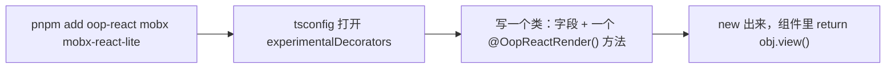

从零到第一个界面是四步：



## 安装

```bash
pnpm add oop-react mobx mobx-react-lite
```

`react`、`react-dom`（`>=18.2`）、`mobx`（`^7`）与 `mobx-react-lite`（`^5`）都是 peer 依赖，必须由宿主项目
提供，见下面的「mobx 只能有一份」。追踪用 MobX，React 绑定用官方的 `mobx-react-lite`（`observer`），不是自己
写的 `Reaction` 循环。

**只跟最新大版本。** mobx 6 要配 `mobx-react-lite@4`，那是另一套 peer，混在一起只会解析出不能用的组合，
所以这里不做兼容分支 —— 宿主升级到 mobx 7，或者继续用旧版本的旧包。

## 第一条配置：严格模式已经关好了

`oop-react` 加载时会自动执行 `configure({enforceActions: 'never'})` —— 这是它唯一替你做的全局配置。

MobX 默认会为「不在 action 里的写入」逐条打印 `console.warn`，而这套模型的写法本来就是 `this.count += 1`：
字段是状态，改它就是这一行。那些告警在这里全是噪音。**关掉的只是警察，不是事务**：方法本来就是 action
（一次调用里写三个字段只通知一次），需要块级事务就 `runInAction`，想把方法显式标成事务就 `@OopReactAction()`。

要恢复严格模式：

```ts
OopReactConfigure({enforceActions: 'always'});   // 或 'observed'
```

详见[状态](./guide/state.md)。

## 打开装饰器

`@OopReactRender()` 用的是旧版装饰器语义：

```json title="tsconfig.json"
{
  "compilerOptions": {
    "experimentalDecorators": true
  }
}
```

Vite、esbuild、SWC、tsc 都支持这个组合；Babel 用 `@babel/plugin-proposal-decorators` 的 `legacy: true`。

## mobx 只能有一份

MobX 把记账信息挂在**每个模块实例各自创建**的 symbol 上，页面里两份 mobx 就会出现「A 造的 observable 在 B
眼里不是 observable」——不报错，只是状态改了界面不动。MobX 自己只在两份版本**不兼容**时告警。

`oop-react` 把 mobx 声明为 peer（`^7`），运行时也会检查并在控制台告警。`mobx-react-lite` 同样是 peer：
它必须和 mobx 用同一份，否则 `observer` 造的 reaction 订阅不到你的 observable。排查：

```bash
pnpm why mobx     # 谁装的、几个版本
pnpm dedupe
```

合并不了就在 `pnpm-workspace.yaml` 里统一：`overrides: {mobx: ^7.1.4}`（npm 用 `package.json` 的
`overrides`，yarn 用 `resolutions`）。

## 一个对象

状态类在自己的构造器里声明什么是状态：

```tsx title="counter.tsx"
import {OopReactObservable, OopReactRender} from 'oop-react';

export class Counter {
  count = 0;

  constructor() {
    OopReactObservable(this);
  }

  increment(): void {
    this.count += 1;
  }

  @OopReactRender()
  view() {
    return <button onClick={this.increment}>{this.count}</button>;
  }
}
```

它在 React 之外创建，用一行接进 React：

```tsx title="app.tsx"
import {Counter} from './counter';

const counter = new Counter();

export function App() {
  return counter.view();
}
```

`App` 没有 state、没有 props、没有 hooks。`counter` 活在模块里（测试里就是 `new Counter()`），`view()` 只
订阅它读到的 `count`。

## 要把它当组件用

需要一个真正的组件（别人用 `<CounterView />` 挂载、或者要往已有 React 页面里塞）时：

```tsx
import {OopReactComponent} from 'oop-react';

export const CounterView = OopReactComponent(Counter, 'view');
```

`OopReactComponent` 会 `new Counter(props)` 并把 props 交给构造函数。这是**桥**，不是主路径，详见
[与 React 衔接](./guide/react-bridge.md)。

下一步：[对象图](./guide/structure.md)。
