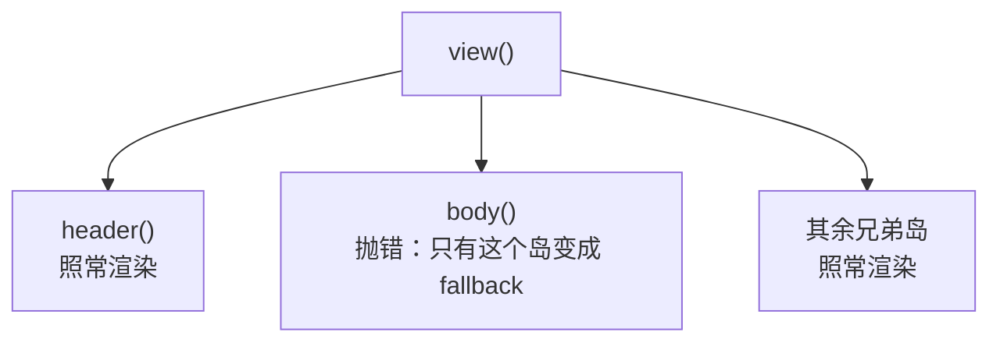

每个渲染方法外面都有一个 React 错误边界。一个方法抛错，只有它那个岛变成 fallback，兄弟岛和父级照常。



```tsx
class Report {
  broken = true;

  constructor() {
    OopReactObservable(this);
  }

  @OopReactRender()
  view() {
    return (
      <section>
        {this.header()}
        {this.body()}   {/* 抛错时只有这里被替换 */}
      </section>
    );
  }

  @OopReactRender()
  header() {
    return <h2>周报</h2>;
  }

  @OopReactRender()
  body() {
    if (this.broken) throw new Error('数据格式不对');
    return <Chart />;
  }
}
```

不用一个包裹整个应用的边界：那会让一次渲染错误吃掉整页，而这里每个岛都是可以独立失败、独立恢复的单位。

## 默认 fallback

不配置时是一个普通的 `<div>`：一行标题、错误信息、一个「Retry」按钮。它刻意不用任何设计系统 —— 库不应该把
antd / MUI 拖进不需要它们的应用。

## 换成自己的

```tsx
import {Alert, Button} from 'antd';
import {OopReactConfigure} from 'oop-react';

OopReactConfigure({
  fallback: ({error, name, reset}) => (
    <Alert
      type="error"
      showIcon
      message={`渲染失败：${name ?? '未知方法'}`}
      description={error instanceof Error ? error.message : String(error)}
      action={
        <Button size="small" onClick={reset}>
          重试
        </Button>
      }
    />
  ),
});
```

- `error`：方法抛出的值；
- `name`：岛的名字，`<类名>.<方法名>` —— 生产构建会压缩类名，所以给人看的地方用
  `@OopReactRender({name: 'FlakySection'})` 显式命名；
- `reset`：清掉错误状态并重新渲染该方法。

**重试的语义**：`reset` 只清除「这个岛失败了」，然后重新执行渲染方法。导致失败的状态还在，它就再抛一次。
真正的恢复一般是先修状态（另一个岛调 `this.recover()`），再点重试 —— 演示站点里的「故障隔离」卡片就是这个流程。

## 上报

```tsx
OopReactConfigure({
  onError: (error, name) => {
    reportToSentry(error, {extra: {island: name}});
  },
});
```

每个渲染方法每次抛错调用一次（和 React 的 `componentDidCatch` 同一时机）。默认实现是 `console.error`。

## 只保护一小段 JSX

```tsx
import {OopReactErrorBoundary} from 'oop-react';

function Legacy() {
  return (
    <OopReactErrorBoundary name="LegacyChart">
      <ThirdPartyChart />
    </OopReactErrorBoundary>
  );
}
```

它用同一套 `fallback` / `onError` 配置。
