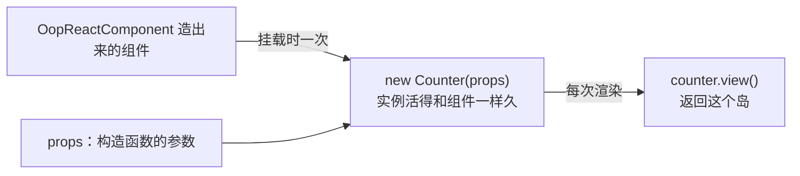

主路径只有一行：普通 React 组件返回岛。

```tsx
export function CartView() {
  return cart.view();
}
```

这一页讲边界上的几件事。

## 主路径的语义

- 组件每次因为父级重渲染而重跑时，`cart.view()` 会返回一个新的岛元素，岛会重跑一次渲染方法 —— 和普通子组件
  一样。岛的独立性体现在**状态变化时**：`cart.count` 变了只重跑读它的那个岛，不牵连兄弟。
- 组件里可以有自己的 hooks（路由参数、antd 表单实例），但它们不该成为业务状态的家。

## 需要真正的组件时：`OopReactComponent`

```tsx
import {OopReactComponent} from 'oop-react';

export const CounterView = OopReactComponent(Counter, 'view');
```

它做三件事：`new Counter(props)` 一次、让实例可观察（类自己声明过就是空操作）、渲染 `view`。适用场景：



- **渐进式采用**：这一屏是新写的对象图，外面还是老的 React 页面；
- **组件契约**：路由、antd 的 `Modal`/`Tabs`、别人写的 `<YourComponent />` 需要一个组件；
- **props 是入口**：调用方是陌生代码，只有 props 这一个通道。

### props 与构造器

```tsx
class Editor {
  title: string;
  readonly store: ArticleStore;

  constructor(props: {title: string; store: ArticleStore}) {
    this.title = props.title;
    this.store = props.store;
    OopReactObservable(this, {store: false});
  }

  @OopReactRender()
  view() {
    return <h2>{this.title}</h2>;
  }
}

export const EditorView = OopReactComponent(Editor, 'view');
```

实例**只创建一次**：父组件重渲染、props 变化都不会重建。构造函数的副作用只发生一次，字段不会被重置，
方法引用保持稳定。

### props 变了怎么办

```tsx
export const EditorView = OopReactComponent(Editor, 'view', {
  onPropsChange: (instance, props) => instance.syncTitle(props.title),
});
```

挂载后和每次 props 变化后调用。注意它是**方法调用**：状态变更落在类的 action 里。

### 选项

| 选项 | 用途 |
| --- | --- |
| `name` | 组件与它的岛的名字前缀（DevTools、fallback、`onError`） |
| `autoObservable` | 默认 `true`；类自己声明过可观察性就没区别 |
| `annotations` | 由本工厂声明可观察性时的字段覆盖（类型跟着 `Instance` 走） |
| `onPropsChange` | props 变化后的同步钩子 |

## 什么时候用哪个

| 情况 | 用法 |
| --- | --- |
| 应用自己的页面、内部对象 | 普通组件返回 `obj.view()` |
| 一个对象要嵌进别人的 React 树 | `OopReactComponent` |
| 只有一段 JSX 要订阅 | `OopReactObserver(render)` |
| render prop / 回调返回 JSX | `OopReactCallback(render)` |

一句话：**`OopReactComponent` 是桥，不是地基。** 如果整个应用都写成一堆 `OopReactComponent(...)`，
你就退回到「一个组件一个类」，白白丢掉了对象图。
