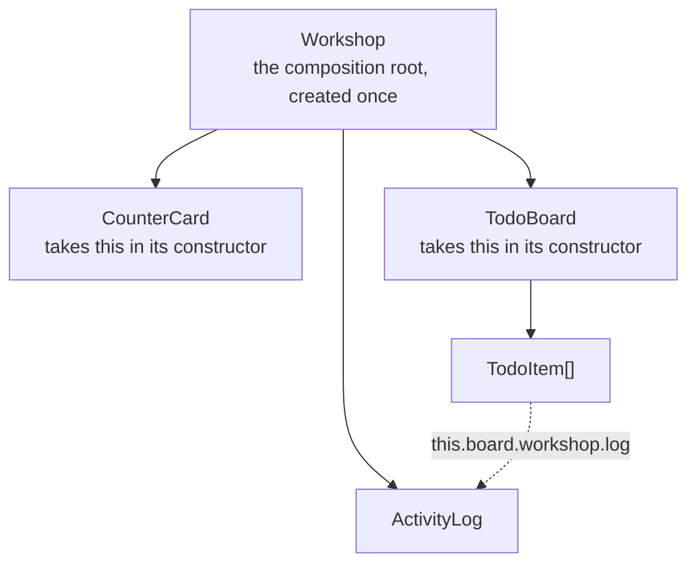

An application is a set of state objects plus a map of who holds whom. That map is where the logic lives; React only
hangs the outermost island onto the page.

The demo's map looks like this — the composition root builds its collaborators, and a grandchild reaches its
grandparent's log through the references:



## Who news whom

```tsx title="main.tsx — the composition root"
import {Workshop} from './workshop/Workshop';

const workshop = new Workshop(); // the root object, created once

createRoot(document.getElementById('root')!).render(<WorkshopView workshop={workshop} />);
```

```tsx title="workshop/Workshop.tsx — the root builds its collaborators"
export class Workshop {
  readonly log: ActivityLog;
  readonly counter: CounterCard;
  readonly todos: TodoBoard;

  constructor() {
    this.log = new ActivityLog();
    this.counter = new CounterCard(this);
    this.todos = new TodoBoard(this);
    OopReactObservable(this, {
      log: false,
      counter: false,
      todos: false,
    });
  }
}
```

Two rules worth noticing:

- **Children first, then declare your own state.** `makeAutoObservable` only sees the fields that exist when it is
  called.
- **`false` means "that field is somebody else, not my state".** Each child already declared its own observability;
  the parent re-observing it adds nothing. Fields that *are* the parent's state (like `selected`) stay observed.

## A grandchild calling its grandparent

```tsx title="workshop/TodoItem.tsx"
export class TodoItem {
  readonly title: string;
  readonly board: TodoBoard;
  done = false;

  constructor(title: string, board: TodoBoard) {
    this.title = title;
    this.board = board;
    OopReactObservable(this, {title: false, board: false});
  }

  toggle(): void {
    this.done = !this.done;
    // through the board, up to the grandparent's log
    this.board.workshop.log.add(`"${this.title}" → ${this.done ? 'done' : 'open'}`);
  }

  @OopReactRender({key: 'title'})
  row() {
    return (
      <li>
        <input type="checkbox" checked={this.done} onChange={this.toggle} />
        {this.title}
      </li>
    );
  }
}
```

Tick that row and the activity log at the bottom of the page updates itself. The two objects are not related
parent-to-child, and there is no event channel between them: one reaction reads a field the other wrote.

In React the same job usually means threading a callback four levels down, inventing a context, or stuffing a
parent's setState into a `useRef`. Here it is `this.board.workshop.log.add(...)`.

## Four relationships

| Relationship | How it looks | Example |
| --- | --- | --- |
| one-to-one | `readonly detail: Detail` | the selected todo, the current user |
| one-to-many | `items: TodoItem[]` | a todo list, the rows of a table |
| many-to-one | a child holding its parent | `readonly board: TodoBoard` |
| across levels | follow the references | `this.board.workshop.log` |

Nothing has to flow downwards only: a grandchild holds its grandparent, siblings call each other.

## Dependencies come from the constructor

```tsx
export class TodoBoard {
  readonly workshop: Workshop;

  constructor(workshop: Workshop) {
    this.workshop = workshop;
    OopReactObservable(this, {workshop: false});
  }
}
```

Dependencies are constructor arguments, so a test can hand in a fake:

```ts
const workshop = {log: {add: vi.fn()}} as unknown as Workshop;
const board = new TodoBoard(workshop);
```

Avoid `import`ing a singleton inside a class — unless it really is global (config, i18n, the logging backend),
it only makes testing and reuse harder.

## Reference cycles

`Workshop` holds `TodoBoard`, which holds `Workshop` back. Use `import type` to break the runtime cycle; type
checking is unaffected:

```ts
import type {Workshop} from './Workshop';
```

## The framework layer is objects too

Routing, theming and language — the things that usually mean installing a library — are just nodes in the graph:

```tsx
export class Router {
  readonly pages: Page[];
  path: string;                       // the only observable part

  constructor(pages: Page[]) {
    this.pages = pages;
    this.path = location.hash.replace(/^#\//, '') || pages[0].path;
    window.addEventListener('hashchange', () => this.sync());
    OopReactObservable(this, {pages: false});
  }

  get current(): Page {              // computed: recalculated when path changes
    return this.byPath(this.path);
  }
}
```

Switching pages is `router.go(page)` writing one field, and the island that reads `router.current` re-renders. The
same holds for theme and language: `theme` and `locale` on a `Settings` object, subscribed by whoever reads them.
The demo's menu, dark mode and EN/中文 switch all work this way — no router library, no i18n library, no context.

## When not to do this

- **Component APIs take props.** When the caller is unknown React code, props are the contract; the object graph is
  internal to the application.
- **Modules that ship separately, or belong to another team**, should depend on interfaces and props rather than
  requiring the other side to `new` your classes.
- **The graph is invisible in React DevTools.** The component tree shows islands; the business structure lives in
  the code or in your own logs. That is the tax of this model — choose it knowingly.

## Cheat sheet

| What you would write in React | Here |
| --- | --- |
| `useState` | a field |
| `useCallback` / `useMemo` | a bound method / a `computed` getter |
| threading a callback down | calling a method on the object that holds it, or that it holds |
| `useContext` | holding that object |
| lifting state to a common parent | no lifting; whoever needs it holds it |
| `useRef` to keep an instance | `readonly xxx = new Xxx()` |
