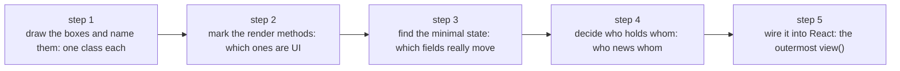

A parallel version of React's [Thinking in React](https://react.dev/learn/thinking-in-react): the same searchable
product table, the same five steps, only each step asks "which objects?" instead of "which components?".

Read the two side by side. The order is the same; what changes is what you are holding at the end of each step —
there a component tree and a pile of props, here an object graph and a few render methods.



## Start from the mockup and the data

The mockup: a search field, an "only show products in stock" checkbox, and a table grouped by category
(name + price, out-of-stock names in red). The data is still the official one:

```json
[
  {"category": "Fruits", "price": "$1", "stocked": true, "name": "Apple"},
  {"category": "Fruits", "price": "$1", "stocked": true, "name": "Dragonfruit"},
  {"category": "Fruits", "price": "$2", "stocked": false, "name": "Passionfruit"},
  {"category": "Vegetables", "price": "$2", "stocked": true, "name": "Spinach"},
  {"category": "Vegetables", "price": "$4", "stocked": false, "name": "Pumpkin"},
  {"category": "Vegetables", "price": "$1", "stocked": true, "name": "Peas"}
]
```

When the JSON is shaped well, the UI and the data model tend to have the same shape — true on both sides.
What differs is where the data lands: in React it becomes some component's `props`, here it is mapped into objects
at the entry point, and after that there is no "raw data" left.

## Step 1: break it into objects, not components

You still draw boxes on the mockup and name them. **Every box is a responsibility, and a responsibility is a
class** — the next four steps all rest on that call.

| Box on the mockup | React | Here |
| --- | --- | --- |
| the whole app | `FilterableProductTable` | `CatalogPage` |
| the search bar | `SearchBar` | `SearchBar` |
| the table | `ProductTable` | `ProductTable` |
| a category row | `ProductCategoryRow` | `Category` |
| a product row | `ProductRow` | `Product` |

The product row is the one people drop first: "it is a single line of JSX inside a `map`; making it
`table.row(product)` saves a file." What it saves on is `this`:

```tsx title="catalog/Product.tsx"
export class Product {
  constructor(
    readonly category: string,
    readonly price: string,
    readonly stocked: boolean,
    readonly name: string,
  ) {}

  @OopReactRender({key: 'name'})
  row() {
    return (
      <tr>
        <td className={this.stocked ? undefined : 'out-of-stock'}>{this.name}</td>
        <td>{this.price}</td>
      </tr>
    );
  }
}
```

Rewritten as `row(product)` on the parent, the first line is usually
`const {name, price, stocked} = product;` — you write just as much, and what you get is three read-only local
variables. `this` is not syntax sugar you can cancel out; it is that row's own context. A hover state, a "selected"
flag, another object calling `row.select()` later — all of that lives on `this`. **Lose the context and you lose
the capability.**

`Product` is not marked `@OopReactState`: its fields never change, so nothing needs to be observable. The decorator
is about *state*, not about whether something can be drawn — and of the five classes here, only `CatalogPage` has
state.

In React the hierarchy ("who is inside whom") decides who re-renders with whom and how data flows. Here it only
decides who calls whom:

```
CatalogPage
├─ products       a readonly reference: products from the API
├─ filterText     field
├─ inStockOnly    field
├─ categories     Category[], grouped once in the constructor
├─ searchBar      SearchBar (holds the page)
└─ table          ProductTable (holds the page)
```

## Step 2: build the static version

React's rule for the static version is "props only, no state"; its counterpart here is "render methods read fields
and never write them":

```tsx title="catalog/CatalogPage.tsx"
@OopReactState
export class CatalogPage {
  /** A readonly reference: the API gave us this data and nobody changes it, so it is not state. */
  @OopReactIgnore readonly products: Product[];
  /** Interaction is not wired up yet: these two are just initial values for now. */
  filterText = '';
  inStockOnly = false;
  @OopReactIgnore readonly categories: Category[];
  @OopReactIgnore readonly searchBar: SearchBar;
  @OopReactIgnore readonly table: ProductTable;

  constructor(products: Product[]) {
    this.products = products;
    // Grouping depends only on data, and data never changes, so compute it once.
    this.categories = [...new Set(products.map((product) => product.category))].map(
      (category) => new Category(this, category),
    );
    this.searchBar = new SearchBar(this);
    this.table = new ProductTable(this);
  }

  @OopReactRender()
  view() {
    return (
      <div className="catalog">
        {this.searchBar.view()}
        {this.table.view()}
      </div>
    );
  }
}
```

Note `new SearchBar(this)`: the only "passing down" in this model, and it passes **an object to an object**, not data
to data. The search bar receives the page and reads whatever it needs later — there is no "flow" to speak of: one reference
handed over in the constructor, then direct calls.

(Top-down and bottom-up both work. Methods naturally run top-down, so top-down is easier; row methods can come
later.)

The static version hits the same trap as in React: `value={this.page.filterText}` with no `onChange` makes the input
read-only and the console warns `You provided a value prop to a form field without an onChange handler`. That is the
reminder that interaction is not wired yet — Step 5 fixes it.

## Step 3: find the minimal but complete state

React's three questions, one for one:

| Question | React | Here |
| --- | --- | --- |
| 1. Does it stay unchanged over time? | not state | not a field: a readonly reference (`products`) |
| 2. Is it passed in from a parent? | not state | not a field: another object already holds it, reference that |
| 3. Can it be computed from existing state / props? | definitely not state | not a field: a `get` accessor (computed) |

Run the four pieces of data through it:

| Data | Verdict |
| --- | --- |
| the original product list | unchanged → `@OopReactIgnore readonly products` |
| the search text | changes, cannot be derived → **a field** |
| the checkbox | changes, cannot be derived → **a field** |
| the filtered list | derivable → **a computed getter** |

```ts
get visible(): Product[] {
  const text = this.filterText.trim().toLowerCase();
  return this.products.filter((product) => {
    const matchesText = text === '' || product.name.toLowerCase().includes(text);
    return matchesText && (!this.inStockOnly || product.stocked);
  });
}
```

Storing `visible` as a field would mean re-syncing it at every write — that is "a copy of state", just moved from
React into an object. MobX caches a computed for you: the island that reads it recomputes only after `filterText` /
`inStockOnly` change.

That gives two rules: **what never changes is computed once in the constructor** (`categories`); **what changes is
computed in a `get`** (`visible`). Neither should be a field.

### A step deeper: what props and state become

| | React | Here |
| --- | --- | --- |
| read-only data from outside | props | constructor arguments, or another object you hold |
| something you own and change | state (`useState`) | a field |
| who may change it | only the parent (through a setter) | whoever holds it — writing the field or calling a method, same thing |
| what gets passed down | values + callbacks | references (the other side reads and calls) |

In React both props and state "belong to some component". Here the two split cleanly: **a reference is a
relationship, a field is ownership**. Ownership is a design decision (who is responsible for this value), not a
gate — writing it is an assignment, and nothing stops you.

## Step 4: who do these fields belong to

React looks for the closest common parent component, because data can only travel along the component tree. No
channel is needed here: two consumers need not know each other, they only need to hold the owner. So the question
changes from "which component" to:

> Whose state is this, semantically?

Both filter conditions are about "what this page is looking at", not about the search field:

- `CatalogPage` holds `filterText` / `inStockOnly`;
- `SearchBar` reads and writes them, and stores nothing itself;
- `Category` and `ProductTable` read `page.visible`; nothing else to wire.

```tsx title="catalog/SearchBar.tsx"
export class SearchBar {
  constructor(readonly page: CatalogPage) {}

  @OopReactRender()
  view() {
    return (
      <form className="search-bar" onSubmit={(event) => event.preventDefault()}>
        <input value={this.page.filterText} placeholder="Search…" />
        <label>
          <input type="checkbox" checked={this.page.inStockOnly} /> Only show products in stock
        </label>
      </form>
    );
  }
}
```

The other reader: a category row knows its own name and asks the page for the rest.

```tsx title="catalog/Category.tsx"
export class Category {
  constructor(
    readonly page: CatalogPage,
    readonly name: string,
  ) {}

  @OopReactRender()
  row() {
    // `visible` is a computed: when the filter moves, this island re-renders on its own,
    // and the product rows are not dragged along.
    const visible = this.page.visible.filter(
      (product) => product.category === this.name,
    );
    if (visible.length === 0) return null;

    return (
      <>
        <tr>
          <th colSpan={2}>{this.name}</th>
        </tr>
        {visible.map((product) => product.row())}
      </>
    );
  }
}
```

The opposite case matters just as much: a field that belongs only to the input (say "is the advanced filter
expanded") should live on `SearchBar`, and the page should not know about it. **The test is not "who uses it" but
"whose thing is it".**

React's third option — if no parent fits, create one — becomes: **create an object** that everyone who needs it
holds. For instance, lift the filter into a `CatalogFilter` the day the orders page wants to reuse the same
`matches(product)`.

## Step 5: there is no "direction" at all

In React data can only travel one way along the component tree, so it needs a name for each direction: down is "data
flow", up is "inverse data flow". Those are not two features but the two faces of a one-way street — for a value to
be changed from above, the setter has to be handed down level by level, every level accepting it and passing it on
(or a context hiding the relay).

There is no street here, so no direction either. Whoever holds an object can read it, write it and call its methods;
`SearchBar` setting `page.filterText` is the same kind of action as the page setting its own field — neither "up"
nor "down":

```tsx
<input
  value={this.page.filterText}
  onChange={(event) => {
    this.page.filterText = event.target.value;
  }}
/>
<input
  type="checkbox"
  checked={this.page.inStockOnly}
  onChange={(event) => {
    this.page.inStockOnly = event.target.checked;
  }}
/>
```

Writing a field and calling a method are the same thing. A method is just a place to bundle several steps — the
demo's `setXxx` methods also append a log line, which is why they are worth a wrapper; here there is nothing else to
do, so a plain assignment is the whole story. Inventing `setFilterText` "for a single entry point" is ceremony for
its own sake.

Nothing on the table changes: `Category` reads `page.visible` and re-renders when a field moves, while
`Product.row()` takes no arguments and reads no filter field, so it is skipped. No callback relay, no event bus, no
context.

The one thing that must hold: **never write a field inside a render method.** The render is reading while you write,
which invalidates the subscription mid-render (see [render methods](./render-methods.md)). Writes belong in event
handlers or plain methods.

## After the five steps

| React's step | Here |
| --- | --- |
| break the UI into a component hierarchy | break it into objects: one class per box; only changing state needs `@OopReactState` |
| static version with props only | render methods read fields; events not wired |
| three questions to find state | three questions to find fields; anything derivable is computed |
| lift state to the closest common parent | put state on the object it belongs to; consumers hold a reference |
| pass setters down as callbacks | no direction: whoever holds it reads and writes, or calls a method |

Only two fields actually change in this example, so the graph is small: a page object and four children (`Product`
is data, `Category` is the grouping, `SearchBar` is the input, `ProductTable` is the shell). Another screen looks
different — the demo's orders page keeps table state, a form instance and a dialog flag on objects, and the log
shared across pages is a field on `App`, see [the object graph](./structure.md).

Keep reading: [state](./state.md) · [render methods](./render-methods.md) ·
[complex components and hooks](./complex-components.md)

## When not to think this way

- **A published component API uses props.** When the caller is unfamiliar React code, props are the contract; an
  object graph is for the inside of an application.
- **Reusing a piece of UI inside somebody else's React tree** is a plain component, or a
  [component bridge](./react-bridge.md).
- **Things that are not boxes should not become classes.** Grouping, formatting, validation — computation without a
  context — is better as a plain function; it has no use for `this`, so it should not take a class's place. The
  lesson here is to cut by box and by responsibility, not to wrap every function in a shell.
