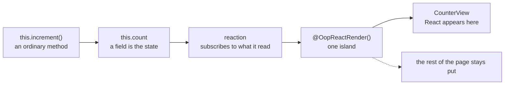

import {registerDfkElements} from 'duckfn-docs-kit';

import DemoAction from '@site/src/components/DemoAction';

import styles from '@site/src/pages/index.module.css';

{/* The hero, the feature grid and the next-step row are the kit's custom
    elements (`duckfn-docs-kit`), not hand-written markup: each builds its own
    shadow tree and carries its own CSS. Registering twice is a no-op, and the
    kit's client bootstrap defines the same tags on every page — this call only
    covers this page's first paint.

    `MDXPage` supplies the `<Layout>` and the page grid; `dfk-home` is what lets
    `src/css/home.css` give the page the full width it needs.

    The `href`s the kit's elements take are *relative* (`./getting-started`).
    Unlike a markdown link, an attribute on a custom element never goes through
    Docusaurus' link resolution, so an absolute `/getting-started` would keep the
    deploy sub-path but lose the locale prefix, landing an English reader on a
    Chinese page. A relative path resolves against whatever directory this page
    was served from, which is right at the site root, under a sub-path, and here
    under `/en/`, alike. */}

{registerDfkElements()}

<dfk-hero
  logo-src="/img/logo.png"
  title="oop-react"
  tagline="State and behaviour stay in a plain class, and only methods annotated with @OopReactRender() re-render. Objects hold each other and call methods directly; React appears once, at the edge.">

<dfk-action kind="primary" href="./getting-started">Get started</dfk-action>

<DemoAction>Live demo</DemoAction>

</dfk-hero>

<dfk-features section-title="Why use it">

<dfk-feature icon="lucide:variable" title="Fields are state">
No useState, no setter functions. Changing state is this.count += 1.
</dfk-feature>

<dfk-feature icon="lucide:mouse-pointer-click" title="Methods are callbacks">
this.save is the onClick handler. Methods are bound once, so the reference never changes.
</dfk-feature>

<dfk-feature icon="lucide:layers" title="Re-renders stay in the island">
An @OopReactRender() method subscribes only to the fields it reads. Its siblings do not move.
</dfk-feature>

<dfk-feature icon="lucide:shield-check" title="One boundary per island">
If a render method throws, only that island becomes a fallback. The rest keeps working.
</dfk-feature>

<dfk-feature icon="lucide:network" title="Logic does not move">
Objects hold each other and call methods directly — no lifting state, no threading callbacks down.
</dfk-feature>

<dfk-feature icon="lucide:settings-2" title="Defaults are replaceable">
Subscription, observability, fallback and error reporting are configuration, not hidden implementation.
</dfk-feature>

</dfk-features>

<section className={styles.showcase}>
<div className={styles.showcaseInner}>

## One class, one picture

Above, an ordinary class. Below, what actually happens at run time: a field is written, the reactions that read it are notified, and only that island re-renders.

<div className={styles.showcaseBody}>

```tsx title="counter.tsx"
import {OopReactComponent, OopReactRender, OopReactState} from 'oop-react';

@OopReactState
class Counter {
  count = 0;

  increment(): void {
    this.count += 1;
  }

  @OopReactRender()
  view() {
    return <button onClick={this.increment}>{this.count}</button>;
  }
}

export const CounterView = OopReactComponent(Counter, 'view');
```



</div>

</div>
</section>

<dfk-next-steps section-title="Where to go next">

<dfk-step href="./intro" title="What it solves">
See why state inside a component function drags those patches along, and what this model replaces.
</dfk-step>

<dfk-step href="./getting-started" title="Getting started">
Install it, write your first class, and mount its view().
</dfk-step>

<dfk-step href="./guide/structure" title="The object graph">
Who constructs whom, how objects hold each other, and where dependencies come from.
</dfk-step>

<dfk-step href="./guide/thinking-in-objects" title="Thinking in objects">
Five steps, walked through on an existing React page.
</dfk-step>

</dfk-next-steps>
