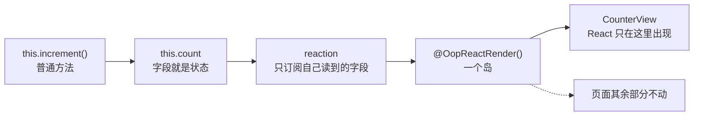

import {registerDfkElements} from 'duckfn-docs-kit';

import DemoAction from '@site/src/components/DemoAction';

import styles from '@site/src/pages/index.module.css';

{/* The hero, the feature grid and the next-step row are the kit's custom
    elements (`duckfn-docs-kit`), not hand-written markup: each builds its own
    shadow tree and carries its own CSS. Registering twice is a no-op, and the
    kit's client bootstrap defines the same tags on every page — this call only
    covers this page's first paint.

    `MDXPage` supplies the `<Layout>` and the page grid; `dfk-home` is what lets
    `src/css/home.css` give the page the full width it needs.

    The `href`s the kit's elements take are *relative* (`./getting-started`).
    Unlike a markdown link, an attribute on a custom element never goes through
    Docusaurus' link resolution, so an absolute `/getting-started` would keep the
    deploy sub-path but lose the locale prefix, landing an English reader on a
    Chinese page. A relative path resolves against whatever directory this page
    was served from, which is right at the site root, under a sub-path, and under
    `/en/` alike. */}

{registerDfkElements()}

<dfk-hero
  logo-src="/img/logo.png"
  title="oop-react"
  tagline="状态和行为留在一个普通类里，只有被 @OopReactRender() 注解的方法参与重渲染。对象之间相互持有、直接调用，React 只在最外层出现一次。">

<dfk-action kind="primary" href="./getting-started">快速开始</dfk-action>

<DemoAction>在线演示</DemoAction>

</dfk-hero>

<dfk-features section-title="为什么用它">

<dfk-feature icon="lucide:variable" title="字段就是状态">
没有 useState，也没有 setter 函数。改状态就是 this.count += 1。
</dfk-feature>

<dfk-feature icon="lucide:mouse-pointer-click" title="方法就是回调">
this.save 直接当 onClick。实例方法已经绑好，引用永远稳定。
</dfk-feature>

<dfk-feature icon="lucide:layers" title="重渲染只在岛里">
@OopReactRender() 方法只订阅自己读到的字段，兄弟节点一动不动。
</dfk-feature>

<dfk-feature icon="lucide:shield-check" title="一个岛一个边界">
某个渲染方法抛错，只有它变成 fallback，其余部分照常工作。
</dfk-feature>

<dfk-feature icon="lucide:network" title="逻辑不搬家">
对象之间相互持有、直接调用方法，不需要状态提升和回调下传。
</dfk-feature>

<dfk-feature icon="lucide:settings-2" title="默认实现可替换">
订阅、可观察化、fallback、错误上报都是配置项，换掉不留后门。
</dfk-feature>

</dfk-features>

<section className={styles.showcase}>
<div className={styles.showcaseInner}>

## 一段代码，一张图

上面是一个普通的类，下面是它运行时真正发生的事：写一个字段、通知读过它的 reaction、只有那个岛重渲染。

<div className={styles.showcaseBody}>

```tsx title="counter.tsx"
import {OopReactComponent, OopReactRender, OopReactState} from 'oop-react';

@OopReactState
class Counter {
  count = 0;

  increment(): void {
    this.count += 1;
  }

  @OopReactRender()
  view() {
    return <button onClick={this.increment}>{this.count}</button>;
  }
}

export const CounterView = OopReactComponent(Counter, 'view');
```



</div>

</div>
</section>

<dfk-next-steps section-title="接下来">

<dfk-step href="./intro" title="它解决什么">
先看清组件函数里的状态为什么会带来那些补丁，再看这套模型换掉了什么。
</dfk-step>

<dfk-step href="./getting-started" title="快速开始">
装包、写第一个类、把 view() 挂到页面上。
</dfk-step>

<dfk-step href="./guide/structure" title="对象图">
谁 new 谁、对象之间怎么相互持有、依赖从哪来。
</dfk-step>

<dfk-step href="./guide/thinking-in-objects" title="用对象的方式思考">
跟着五步，把一个已有的 React 页面改成对象图。
</dfk-step>

</dfk-next-steps>
